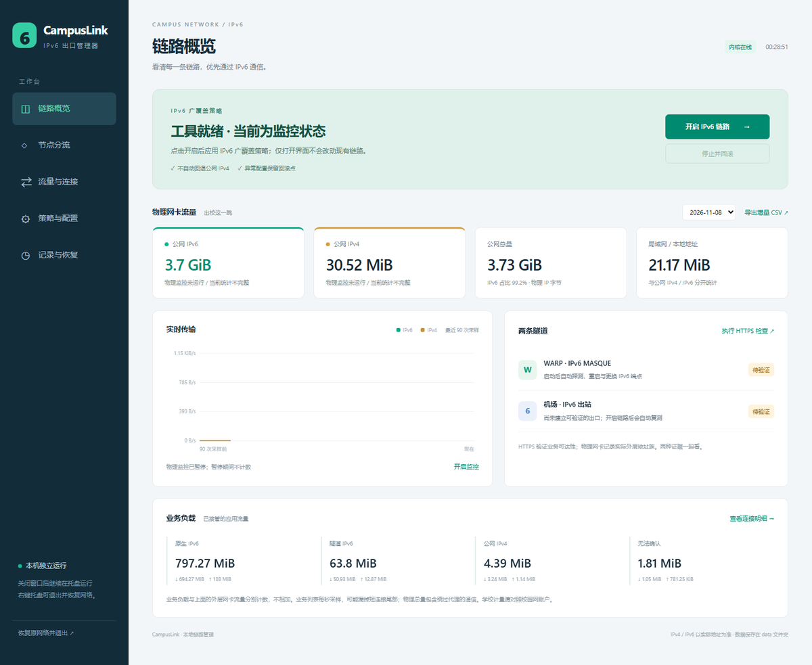
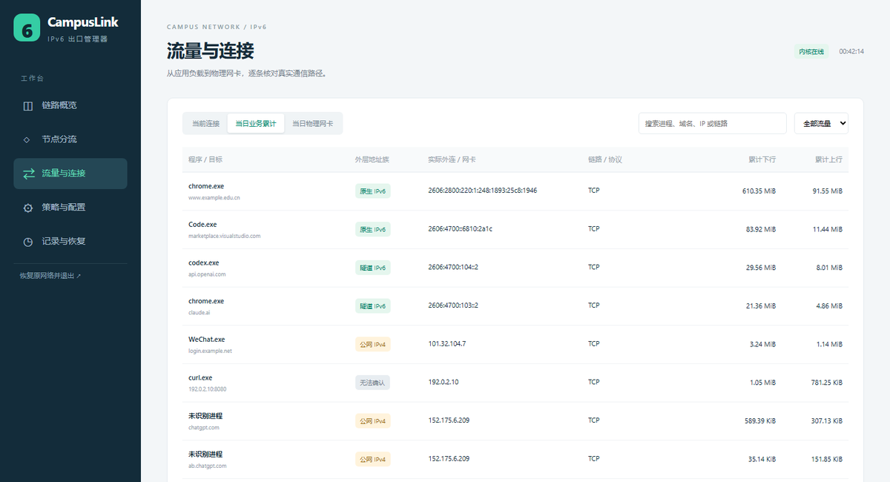
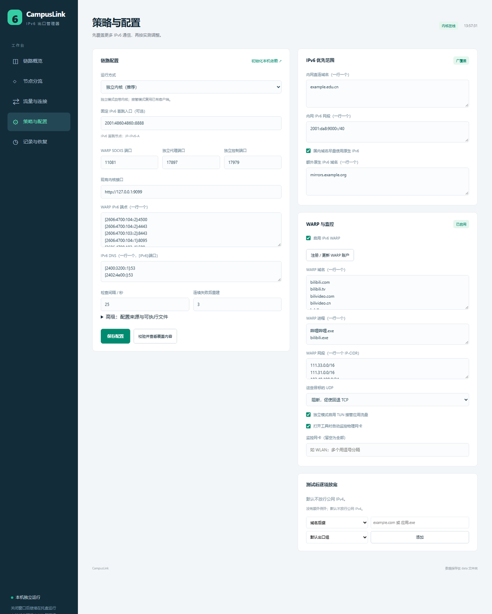

# CampusLink

**Windows 上的 IPv6 出口管理器。** 让能走 IPv6 的流量都走 IPv6，需要隧道时优先 WARP，机场可选；每次开启前先落一份完整回滚点，失败自动还原。

> **English:** CampusLink is a Windows desktop app that makes IPv6 the default egress for a mihomo kernel. It auto-registers a Cloudflare WARP account, falls back to native IPv6 where possible, optionally chains an airport over a pinned IPv6 first hop, and keeps verified rollback for every change. Requires Windows 10/11, a `mihomo` binary and `warpscout`; an airport subscription is optional. UI is Chinese. MIT licensed.



## 用它做什么

**主力是两件事：看视频，和跑 Agent。**

- **视频**：B 站这类站点大量使用 UDP（QUIC）。只把 TCP 指向代理时，UDP 仍会落到公网 IPv4 上。工具默认把这些域名、进程和 CDN 网段交给 WARP，同时阻断其 UDP，播放器会自动回退到 TCP，外层全程是 IPv6。
- **Agent / AI 工具**：ChatGPT、Claude、Codex 这类进程与域名单独走「AI 服务组」，可以指定美国或任意地区出口，不影响其他流量。
- **日常使用**：微信、浏览器、系统更新不需要特别处理。国内域名优先走原生 IPv6，其余按默认出口处理——没有机场时是 WARP，有机场时是所选节点。

**最舒服的状态是「WARP + 机场」都可用**：WARP 承接视频和那些不想占机场流量的连接，机场负责换地区和其余代理流量。在这种配置下，物理网卡上记录的公网流量里 IPv6 占比通常可以做到 **99% 以上**——剩下的那一点基本是只支持 IPv4 的登录接口、支付和个别 App 的心跳。没有机场也能跑，只是换不了地区。

> 占比高低取决于目标站点有没有 AAAA 记录、以及你有没有为只有 A 记录的服务加 IPv4 例外。数字以「流量与连接」页的物理网卡统计为准，账单仍以网络提供方的账户为准。

## 它解决什么问题

多数人改 IPv6 的做法是手改一份 Clash 配置，把 `ip-version` 调成 `ipv6`。这条路有三个坑：

| 坑 | 直接改配置的后果 | CampusLink 的做法 |
|---|---|---|
| 改坏了怎么回去 | 只能凭记忆把文件抄回来 | 开启前保存内核配置、TUN 状态、系统代理与策略组选择；一键回滚并逐项校验 |
| 谁在偷偷走 IPv4 | 只有总量，看不出是哪个程序、哪个域名 | 物理网卡抓包与内核连接列表分别记账，IPv4/IPv6/隧道/无法确认四类分开显示 |
| IPv6 与 UDP 的差异 | `ipv6` 只对 TCP 生效，UDP 静默走 IPv4 | 未确认地址族的 UDP 交给支持 UDP 的 IPv6 出口；没有出口时明确阻断，不偷偷回落 |

它不生成"一份更聪明的配置"就完事，而是把**接管、验证、回滚**当成一件事来做。

## 三条路径

| 路径 | 走法 | 什么时候用 |
|---|---|---|
| 原生 IPv6 | 本机直连 IPv6 | 目标有 AAAA 且线路可达 |
| IPv6 WARP | 本机 `warpscout` SOCKS → Cloudflare MASQUE | 需要一条不占机场流量的出口；视频、普通代理默认走这里 |
| IPv6 机场 | 固定 IPv6 首跳 → 所选出口 | 需要换地区；没有机场时这条路径整体不存在 |

WARP 是开箱可用的：首次初始化会自动 `warpscout register` 注册一个免费账户，不需要你去官网注册、复制密钥。机场是可选的，没有它就只跑「原生 IPv6 + WARP」。



## 为什么不是又一份配置生成器

1. **回滚是可验证的，不是"应该能恢复"。** 开启前把内核配置、TUN、系统代理、策略组选择写成 `data/recovery.json`；恢复时校验备份路径、校验和、端口快照与标记，任何一项不符就报错并保留记录，不假装成功。
2. **只结束自己启动的进程。** 恢复记录里存 PID + 可执行文件路径 + 进程创建时间，三者全中才终止，避免误杀复用了 PID 的程序。
3. **口径分开。** 物理网卡字节（包含绕过代理的流量）与业务负载（内核连接增量）分别计算、不相加；名称里带 WARP 或 `[v6]` 不作地址证据，`DIRECT` 也不等于 IPv6。
4. **失败即关闭。** 节点断言、地址断言、`mihomo -t` 校验、端口占用检查，任何一步不过都不发布候选配置。

## 安装

需要 Windows 10/11 x64、一个 `mihomo` 内核。WARP 需要 `warpscout`（工具会自己注册账户），机场可选。这两个可执行文件都可以用 `tools\get-deps.ps1` 从官方 Release 一键下载。

**方式一：发布版（推荐）**

下载 Releases 里的 `CampusLink-windows-x64.zip`，**先右键 zip → 属性 → 勾选“解除锁定”**，再解压到任意目录，双击 `启动 CampusLink.cmd`。首次启动会请求管理员权限，因为它要接管 TUN 和系统代理。

### Windows 提示“已保护你的电脑”

exe 没有买代码签名证书，从浏览器下载后第一次运行会被 SmartScreen 拦一次。三条路，任选：

| 做法 | 效果 |
|---|---|
| **解压前解除锁定**（推荐） | 右键 zip → 属性 → 勾选“解除锁定”。解压出来的文件不再带 Internet 标记，之后不会再提示 |
| 已解压，双击 `启动 CampusLink.cmd` | 启动器会先对整个目录执行 `Unblock-File`，再拉起 exe |
| 直接双击 exe 被拦 | 点“更多信息”→“仍要运行”，只需一次 |

发布包里带 `SHA256SUMS.txt`，可以 `certutil -hashfile` 核对；源码运行（`python app.py`）完全不走这条路径，也不会触发提示。

**方式二：源码运行**

```powershell
git clone <本仓库>
cd CampusLink
python -m pip install -r requirements.txt
powershell -ExecutionPolicy Bypass -File tools\get-deps.ps1        # 下载 mihomo 与 warpscout 到 vendor\
powershell -ExecutionPolicy Bypass -File tools\build_desktop.ps1   # 编译原生窗口与托盘
python tools/selfcheck.py      # 看缺什么：内核、warpscout、Npcap
python app.py
```

没有编译 `_desktop` 时界面会退回默认浏览器——功能一样，只是没有托盘。

### 第一次使用

1. 点 **下载内核与 warpscout**（首次必点，约 75MB）。工具会从官方 Release 取来内核与 WARP 客户端，顺手识别机场配置、注册 WARP 账户。
2. 点 **校验并查看覆盖内容**，确认规则和代理列表符合预期。
3. 点 **开启 IPv6 链路**。TUN 模式需要管理员权限。
4. 出问题点 **停止并回滚**，恢复开启前的内核配置、TUN 与系统代理。

`vendor/` 里已经有 `mihomo.exe` 与 `warpscout.exe` 时，按钮只做初始化和注册，不会重复下载。

> `data/`、`vendor/` 不入库。`data/` 里是本机凭据、订阅快照、SQLite 与回滚点，`vendor/` 里是内核与规则数据。迁移时两个目录一起带走。

## 默认策略

| 流量 | 处理 |
|---|---|
| WARP 端点、机场 IPv6 入口 | 精确地址放行，包含 UDP/443 |
| 回环、私有网段、内网直连域名/网段 | 直连 |
| B 站域名、CDN 网段、播放器进程 | TCP 走 WARP；UDP 阻断，促使回退 TCP |
| AI 域名与进程 | AI 服务组所选节点 |
| 其余需要代理的连接 | 默认出口组；没有机场时就是 WARP |
| 已知公网 IPv6 字面量 | 原生 IPv6 直连 |
| 其余 | 默认出口组，**不自动回退公网 IPv4** |

DNS 上游只用 IPv6 字面量，不继承原配置的 IPv4 DNS / DoH 覆盖。



## 配置项

设置页可以直接改，「高级」里的路径类配置也可以写进 `data/settings.json`。

| 键 | 含义 |
|---|---|
| `mode` | `standalone` 自带内核；`attach` 接管已有内核（热加载配置，不改订阅文件） |
| `source_config` | 完整 mihomo 配置路径；留空则自动查找 Clash Verge 运行时配置 |
| `kernel_path` / `warp_path` / `warp_account` | 内核、`warpscout`、WARP 账户路径；留空自动查找 |
| `airport_ipv6` | 固定 IPv6 首跳入口。**留空即「仅 WARP」模式**，不加载机场节点 |
| `campus_domains` | 内网直连域名（校园门户、统一认证等），走本机直连并优先 IPv6 |
| `campus_cidrs` | 额外直连的 IPv6 网段 |
| `native_domains` | 强制原生 IPv6 的额外域名 |
| `native_cn` | 国内域名尽量走原生 IPv6（依赖 `geosite.dat`） |
| `warp_domains` / `warp_processes` / `warp_cidrs` | 走 WARP 的域名、进程与 IPv4 网段；默认已含 B 站 |
| `warp_udp` | 这些目标的 UDP：`block` 阻断促使回退 TCP，或 `airport` 交给 IPv6 机场 |
| `warp_enable` | 关闭后不加载 `CL-WARP`，也不生成相关规则 |
| `exceptions` | 逐项放宽：`domain`/`process` × `airport`/`ai`/`warp`/`native`/`ipv4`/`block` |
| `default_node` / `ai_node` | 默认出口与 AI 服务组各自选择的节点（需要机场） |
| `dns` / `endpoints` | IPv6 DNS 上游与 WARP 端点，均为 `[IPv6]:端口` |
| `socks_port` / `mixed_port` / `core_api_port` | WARP SOCKS、独立代理、独立控制端口 |

### 常见调整

**校园网门户走内网**：`campus_domains: ["example.edu.cn"]`。这些域名会排除 fake-ip，用真实地址解析。

**视频站不占机场流量**：默认配置就是这样。TCP 走 WARP，UDP 被拒绝后播放器回退 TCP。想换成机场传 UDP，把 `warp_udp` 改成 `airport`。

**只有 IPv4 的服务**：在例外里加 `{"kind":"domain","value":"example.com","route":"ipv4"}`。这是唯一会让该目标走公网 IPv4 的入口，删除即撤销。

**AI 走另一个地区**：在「节点分流」里给 AI 服务组单独选节点；未选中 IPv6 入口的普通节点会自动经固定 IPv6 首跳中转。

## 两种运行方式

- **独立内核（默认）**：内核与 WARP 均由工具管理，用 `17897` 代理、`17979` 控制、`11081` WARP SOCKS。会临时暂停本机已有的 TUN 并接管系统代理，停止时恢复。
- **接管现有内核**：通过 `external-controller` 热加载覆盖策略，复用现有客户端的管理员能力。开启前校对运行规则与文件、保存原配置与策略组选择。

工具不按过期域名模糊匹配节点：首跳必须唯一命中导入时的节点名与入口，所选出口也必须仍然存在。订阅改名或换入口后，先停止回滚、更新订阅、重新导入。

## 监控口径

- **物理网卡**：从已连接的 WLAN/以太网读 Ethernet/IP 头，按远端地址区分公网 IPv4、公网 IPv6、局域网，累计 IP 层长度。包含未经过代理的流量。需要 Npcap 和管理员权限。
- **业务负载**：每秒读内核 `/connections`，用连接 UUID 与开始时间算真实增量。排除隧道进程自身，避免里外双计。
- 两侧分别展示、不相加。采样可能漏掉极短连接和关闭前最后一段字节，物理字节也可能受网卡硬件卸载影响。

## 测试与构建

```powershell
python -m unittest discover -s tests    # 离线回归，不碰网络
python tools/selfcheck.py               # 本机条件：内核、warpscout、Npcap、窗口组件
powershell -ExecutionPolicy Bypass -File build.ps1   # 打包到 dist/CampusLink
```

`.github/workflows/release.yml` 会在打 `v*` 标签时自动跑测试、构建并附到 Release。

## 已知限制

- 仅 Windows：依赖 WFP/TUN、Npcap 与 Win32 网络状态接口。
- 内核与 warpscout 由使用者的机器从官方 Release 下载，本仓库不转发这两个二进制。
- 首次运行需要联网：约 75MB 的两个可执行文件，外加 mihomo 自己下载的约 20MB 地理数据（`geosite.dat`、`geoip.dat`、`Country.mmdb`）。
- 物理流量监控需要 Npcap 与管理员；没有它们时其余功能可用，只是少一侧数据。
- 不提供 IPv4 自动回退。目标只有 A 记录且没加例外时会明确失败。
- 计费结果以网络提供方的账户为准；本工具只负责让流量走 IPv6，不承诺任何计费结果。

## 目录

```
app.py                 本机 HTTP 接口与启动入口
campuslink/config.py   设置、节点断言、配置生成、内核校验、WARP 注册
campuslink/deps.py     从官方 Release 下载内核与 warpscout
campuslink/manager.py  开启/回滚、采样、健康检查
campuslink/capture.py  Npcap 被动抓包与地址分类
campuslink/traffic.py  增量计算与 SQLite 存储
campuslink/warp.py     warpscout 守护与端点重扫
web/                   界面（无外部资源）
desktop/               Windows 原生窗口（C# + WebView2）
tools/                 自检、依赖下载与窗口编译
tests/                 离线回归测试
```

## 参考

[mihomo API](https://wiki.metacubex.one/api/) · [mihomo v1.18.6 direct 实现](https://github.com/MetaCubeX/mihomo/blob/v1.18.6/adapter/outbound/direct.go) · [warpscout](https://github.com/vernette/warpscout) · [MetaCubeXD](https://github.com/MetaCubeX/metacubexd) · [Npcap](https://npcap.com/guide/npcap-devguide.html)

本项目直接调用上述组件，未复制它们的界面代码。

## License

MIT，见 [LICENSE](LICENSE)。
